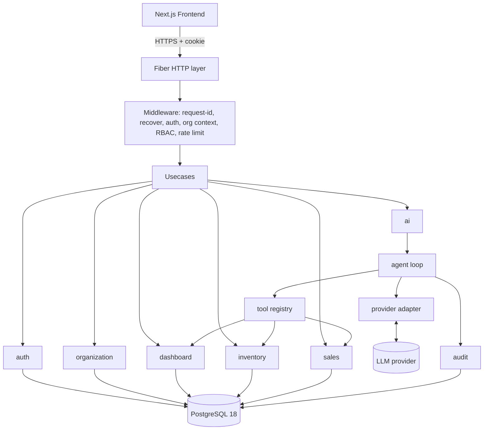

# 02 — Architecture

> Status: Draft

## 1. Style

**Modular Monolith + feature-based packages + Clean Architecture principles**
หนึ่ง Go binary, หนึ่ง PostgreSQL, หนึ่ง Next.js app

## 2. ADR-001 — Modular Monolith instead of Microservices

- **Context:** ทีมเล็ก/part-time, 8 สัปดาห์, ต้อง deploy ผ่าน Docker Compose บน VPS เดียว
- **Decision:** Modular monolith; module สื่อสารกันผ่าน Go interfaces ภายใน process
- **Consequences:** + deploy/debug ง่าย, transaction เดียว, test ง่าย; − scale แยก module ไม่ได้ (ไม่จำเป็นใน MVP); ต้องมีวินัยเรื่อง import boundaries
- **Guardrail:** `features/X` ห้าม import `features/Y/repository` โดยตรง — ใช้ usecase interface ที่ Y export

## 3. ADR-002 — LLM never touches the database

- **Decision:** LLM เห็นเฉพาะ tool definitions; ทุก tool เรียก usecase เดียวกับที่ REST API ใช้
- **Consequences:** ตัวเลขใน AI = ตัวเลขใน Dashboard; ไม่มี text-to-SQL; ความยืดหยุ่นของคำถามจำกัดเท่าที่ tools รองรับ (ยอมรับได้)

## 4. ADR-003 — Custom Go agent loop (no framework)

- **Decision:** เขียน loop เอง ~200–300 บรรทัด: generate → tool_use? → validate → execute → feed back → repeat ≤ N
- **Consequences:** ควบคุม limit/audit ได้เต็มที่, ไม่ผูก framework; ต้องเขียน provider adapter เอง

## 5. ADR-004 — Server-side sessions (Proposed, D-02)

- Session token แบบ random 32 bytes; เก็บ **SHA-256 hash** ใน `user_sessions`; cookie `opspilot_session` httpOnly/Secure/SameSite=Lax
- CSRF: SameSite=Lax + ตรวจ `Origin` header สำหรับ non-GET + custom header `X-Requested-With`
- Alternative: JWT — ปฏิเสธเพราะ revoke ยาก และไม่จำเป็นสำหรับ single API

## 6. Components



## 7. Trusted request context

ทุก request ที่ผ่าน auth middleware จะมี `authctx.Principal` ใน `context.Context`:

```go
type Principal struct {
    UserID         int64
    OrganizationID int64 // from session's active org, verified against organization_members
    Role           Role
    SessionID      int64
}
```

- Handler/usecase/tool อ่าน org จาก `Principal` เท่านั้น
- Repository function ที่อ่าน tenant data **รับ `orgID int64` เป็น parameter แรกเสมอ** และทุก SQL มี `WHERE organization_id = $1`
- Tool argument structs **ไม่มี field organization** — LLM จึงไม่มีทางระบุ org ได้

## 8. Trust boundaries

| Boundary | Untrusted side | Control |
|---|---|---|
| Browser → API | Frontend input | Validation, auth, RBAC, size limit, rate limit |
| API → LLM | Prompt content (user text, DB text) | ถือเป็น data; ไม่มี secrets ใน prompt |
| LLM → Agent | Tool call name/args, final text | Allow-list, JSON schema + business validation, numeric fidelity check |
| Agent → Tool | — | Org จาก Principal, timeout, row limits |
| App → DB | — | Parameterized SQL, least-privilege DB role |

## 9. Backend layout

```text
backend/
├── cmd/
│   ├── api/            # HTTP server
│   └── seed/           # deterministic demo seed (dev/demo only)
├── internal/
│   ├── platform/
│   │   ├── config/     # env parsing + validation
│   │   ├── database/   # pgxpool setup, tx helper
│   │   ├── httpx/      # envelope, error mapping, middleware
│   │   ├── logger/     # slog JSON
│   │   └── clock/      # injectable time for tests
│   ├── shared/
│   │   ├── authctx/    # Principal in context
│   │   ├── apperr/     # typed errors → HTTP codes
│   │   ├── daterange/  # org-timezone date range parsing
│   │   └── money/      # decimal handling
│   └── features/
│       ├── auth/        {handler,usecase,repository,domain}
│       ├── organization/{handler,usecase,repository,domain}
│       ├── dashboard/   {handler,usecase,repository}
│       ├── inventory/   {handler,usecase,repository,domain}
│       ├── sales/       {handler,usecase,repository,domain}
│       ├── ai/          {handler,usecase,agent,tools,provider,domain,repository}
│       └── audit/       {usecase,repository}
├── migrations/          # goose SQL files
└── tests/               # integration tests (build tag: integration)
```

Frontend:

```text
frontend/
├── src/app/
│   ├── (auth)/login/
│   └── (app)/{dashboard,inventory,sales,copilot,copilot/[conversationId],executions/[id],settings/members}/
├── src/features/{auth,dashboard,inventory,sales,copilot}/   # api hooks, components, schemas
├── src/lib/{api-client.ts,query-client.ts,format.ts}
└── tests/{unit,e2e}/
```

Deploy:

```text
deploy/
├── docker-compose.dev.yml
├── docker-compose.prod.yml   # for Portainer stack
├── .env.example
└── backup/                   # pg_dump scripts + restore doc
```

## 10. Agent loop design

```text
Ask(ctx, principal, conversationID, userText):
  validate text length; check rate limit & RBAC
  tools := registry.AllowedFor(principal.Role)
  history := last K messages of conversation (K=10, D-09)
  exec := audit.StartExecution(...)
  ctx = context.WithTimeout(ctx, 60s)
  for i := 0; i < MaxIterations(5); i++:
      resp := provider.Generate(ctx, {system, history, tools, maxTokens})
      record usage
      if resp.ToolCalls empty -> break with resp.Text
      for each call:
          tool := registry.Lookup(call.Name)  // reject unknown / not allowed
          args := tool.Decode(call.Args)        // strict JSON, unknown fields rejected
          tool.Validate(args)                   // ranges, limits
          result := tool.Execute(ctx, principal, args)  // per-tool timeout 5s
          audit.RecordToolCall(...)
          append tool_result to history
  if loop exhausted -> controlled failure
  answer := parseStructured(resp)       // answer, key_findings, limitations, recommendations
  fidelity := checkNumbers(answer, toolResults)
  evidence := built by backend from tool results (not by LLM)
  audit.Finish(exec, status, latency, tokens)
  return answer + evidence + execution_id
```

**Evidence ประกอบโดย backend** จาก tool results จริง — LLM สร้างเฉพาะ text fields

## 11. Configuration (env)

| Var | Example | Note |
|---|---|---|
| `APP_ENV` | `development` | |
| `HTTP_ADDR` | `:8080` | |
| `DATABASE_URL` | `postgres://...` | secret |
| `SESSION_TTL` | `168h` | |
| `CORS_ALLOWED_ORIGINS` | `http://localhost:3000` | |
| `LLM_PROVIDER` | `mock` / `openai_compat` | D-08 |
| `LLM_BASE_URL` | Groq หรือ `http://localhost:11434/v1` (Ollama) | |
| `LLM_API_KEY` | — | secret (Ollama ไม่ต้องใช้) |
| `LLM_MODEL` | เลือกใน P4 จาก model list ของ provider | |
| `AI_MAX_ITERATIONS` | `5` | |
| `AI_TIMEOUT` | `60s` (Ollama `180s`) | |
| `AI_MAX_OUTPUT_TOKENS` | `1024` | |
| `AI_RATE_LIMIT_PER_MIN` | `20` | |
| `INVENTORY_RISK_POLICY` | defaults in code, override via env | single source |
