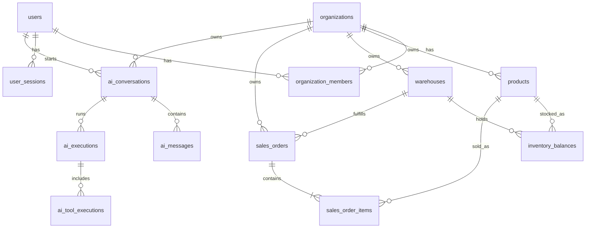

# 03 — ERD & Data Dictionary

> Status: Draft — schema is **not approved**; ห้ามสร้าง migration ก่อนอนุมัติ

## 1. Conventions

- PK: `id BIGINT GENERATED ALWAYS AS IDENTITY`
- Public ID: `public_id UUID NOT NULL DEFAULT uuidv7()` (PostgreSQL 18) — ใช้ใน URL/API; ไม่เปิดเผย BIGINT
- เวลา: `TIMESTAMPTZ` เก็บเป็น UTC; ตัดวันตาม `organizations.timezone`
- เงิน: `NUMERIC(14,2)`; สกุลเงินที่ `organizations.currency` (ISO 4217)
- ทุกตาราง tenant-owned มี `organization_id BIGINT NOT NULL REFERENCES organizations(id)`
- `created_at`, `updated_at TIMESTAMPTZ NOT NULL DEFAULT now()`
- Soft delete: ไม่ใช้ใน MVP ยกเว้น `products.status = 'archived'` (D-11)
- Composite FK `(organization_id, id)` สำหรับความสัมพันธ์ภายใน tenant เพื่อกันการอ้างข้าม org ในระดับ DB

## 2. ERD



## 3. Tables

### users
| Column | Type | Constraints |
|---|---|---|
| id | BIGINT | PK |
| public_id | UUID | UNIQUE |
| email | CITEXT | UNIQUE NOT NULL |
| password_hash | TEXT | NOT NULL (bcrypt) |
| display_name | TEXT | NOT NULL |
| is_active | BOOLEAN | DEFAULT true |
| last_login_at | TIMESTAMPTZ | NULL |

### user_sessions (D-02)
| Column | Type | Constraints |
|---|---|---|
| id | BIGINT | PK |
| user_id | BIGINT | FK users |
| token_hash | BYTEA | UNIQUE NOT NULL (SHA-256) |
| active_organization_id | BIGINT | FK organizations, NULL |
| expires_at | TIMESTAMPTZ | NOT NULL |
| revoked_at | TIMESTAMPTZ | NULL |
| ip, user_agent | TEXT | NULL (truncated) |

Index: `(token_hash)`, `(user_id, revoked_at)`

### organizations
| Column | Type | Constraints |
|---|---|---|
| id, public_id | | |
| name | TEXT | NOT NULL |
| slug | TEXT | UNIQUE |
| timezone | TEXT | NOT NULL DEFAULT 'Asia/Bangkok' |
| currency | CHAR(3) | NOT NULL DEFAULT 'THB' |

### organization_members
| Column | Type | Constraints |
|---|---|---|
| organization_id | BIGINT | FK, PK part |
| user_id | BIGINT | FK, PK part |
| role | TEXT | CHECK IN ('owner','manager','analyst','viewer') |

### products
| Column | Type | Constraints |
|---|---|---|
| id, public_id, organization_id | | UNIQUE (organization_id, id) |
| sku | TEXT | NOT NULL; UNIQUE (organization_id, sku) |
| name | TEXT | NOT NULL |
| category | TEXT | NULL |
| unit_price | NUMERIC(14,2) | list price, ≥ 0 |
| status | TEXT | CHECK IN ('active','archived') |
| tracking_started_at | TIMESTAMPTZ | NOT NULL — ใช้ตัดสิน `insufficient_data` |

### warehouses
| Column | Type | Constraints |
|---|---|---|
| id, public_id, organization_id | | UNIQUE (organization_id, id) |
| code | TEXT | UNIQUE (organization_id, code) |
| name | TEXT | NOT NULL |

### inventory_balances (snapshot — D-04)
| Column | Type | Constraints |
|---|---|---|
| organization_id | BIGINT | |
| product_id | BIGINT | FK (organization_id, product_id) |
| warehouse_id | BIGINT | FK (organization_id, warehouse_id) |
| on_hand | INTEGER | ≥ 0 |
| reserved | INTEGER | ≥ 0, ≤ on_hand |
| available | INTEGER | GENERATED ALWAYS AS (on_hand - reserved) STORED |
| as_of | TIMESTAMPTZ | NOT NULL |

PK `(organization_id, product_id, warehouse_id)`

### sales_orders
| Column | Type | Constraints |
|---|---|---|
| id, public_id, organization_id | | UNIQUE (organization_id, id) |
| order_number | TEXT | UNIQUE (organization_id, order_number) |
| warehouse_id | BIGINT | FK (organization_id, warehouse_id) |
| status | TEXT | CHECK IN ('pending','paid','fulfilled','canceled','refunded') |
| ordered_at | TIMESTAMPTZ | NOT NULL |
| paid_at | TIMESTAMPTZ | NULL |
| subtotal, discount_total, total | NUMERIC(14,2) | total = subtotal − discount_total |

Index: `(organization_id, status, ordered_at)`

### sales_order_items
| Column | Type | Constraints |
|---|---|---|
| id | BIGINT | PK |
| organization_id | BIGINT | |
| sales_order_id | BIGINT | FK (organization_id, sales_order_id) ON DELETE CASCADE |
| product_id | BIGINT | FK (organization_id, product_id) |
| quantity | INTEGER | > 0 |
| unit_price | NUMERIC(14,2) | ≥ 0 (price at sale time) |
| discount | NUMERIC(14,2) | ≥ 0, DEFAULT 0 |
| line_total | NUMERIC(14,2) | GENERATED (quantity*unit_price − discount) |

Index: `(organization_id, product_id)`

### ai_conversations
| Column | Type | Constraints |
|---|---|---|
| id, public_id, organization_id | | |
| user_id | BIGINT | FK users |
| title | TEXT | first question truncated to 80 chars |

### ai_messages
| Column | Type | Constraints |
|---|---|---|
| id, public_id, organization_id | | |
| conversation_id | BIGINT | FK |
| role | TEXT | CHECK IN ('user','assistant') |
| content | TEXT | ≤ 2,000 chars (user), assistant unconstrained |
| structured | JSONB | answer/key_findings/limitations/recommendations |
| execution_id | BIGINT | FK ai_executions NULL |

### ai_executions (one per user question)
| Column | Type | Constraints |
|---|---|---|
| id, public_id, organization_id | | |
| conversation_id, user_id | BIGINT | FK |
| status | TEXT | 'running','succeeded','failed','rejected' |
| failure_code | TEXT | NULL (e.g. `AI_MAX_ITERATIONS`) |
| provider, model | TEXT | |
| iterations | SMALLINT | |
| input_tokens, output_tokens | INTEGER | NULL |
| fidelity_passed | BOOLEAN | NULL |
| started_at, finished_at | TIMESTAMPTZ | |
| latency_ms | INTEGER | |

### ai_tool_executions
| Column | Type | Constraints |
|---|---|---|
| id, public_id, organization_id | | |
| execution_id | BIGINT | FK |
| sequence | SMALLINT | |
| tool_name | TEXT | |
| arguments | JSONB | sanitized |
| status | TEXT | 'succeeded','validation_failed','unauthorized','failed','timeout' |
| result_summary | JSONB | summary + filters + calculation_version (ไม่เก็บ items ทั้งหมด หากเกิน 50 รายการ) |
| error_code | TEXT | NULL |
| duration_ms | INTEGER | |

## 4. Business definitions (Proposed — D-05, D-06)

| Term | Definition |
|---|---|
| Counted order | `status IN ('paid','fulfilled')` |
| Sales date | `ordered_at` แปลงเป็น `organizations.timezone` |
| Gross sales | Σ `quantity × unit_price` ของ counted orders |
| Discounts | Σ item `discount` |
| Net sales | Gross − Discounts (= Σ `line_total`) — ไม่รวม VAT/shipping |
| Order count | จำนวน counted orders |
| Units sold | Σ `quantity` ของ counted orders |
| AOV | Net sales / order count (order count = 0 → null) |
| Canceled/refunded | ไม่นับทั้ง order; partial return ไม่รองรับใน MVP |
| Date range | `from` inclusive, `to` inclusive (วันที่ตาม org timezone) |

## 5. Dashboard KPI definitions

| KPI | Definition |
|---|---|
| Total net sales | ตาม §4 |
| Orders | ตาม §4 |
| In-stock SKUs | จำนวน active products ที่ Σ available (ทุกคลัง) > 0 |
| At-risk SKUs | จำนวน products ที่ risk_level ∈ {critical, high} (aggregate ทุกคลัง, default policy) |

## 6. Inventory risk policy `inventory-risk-v1` (Proposed — D-07)

```
available_stock      = Σ available (filtered warehouses)
units_sold           = Σ quantity, counted orders, ordered_at in [today - lookback_days, today)
average_daily_sales  = units_sold / lookback_days
coverage_days        = available_stock / average_daily_sales     (2 decimal places)

if tracking_started_at > today - lookback_days      -> insufficient_data
elif average_daily_sales == 0                         -> no_recent_sales (coverage = null)
elif coverage_days <= critical_days (2)               -> critical
elif coverage_days <= threshold_days (default 7)      -> high
else                                                  -> normal

suggested_reorder_qty (informational) =
    max(0, ceil(average_daily_sales × target_cover_days(14)) − available_stock)
```

- `available_stock = 0` และมียอดขาย → `coverage_days = 0` → `critical`
- Warehouse filter: ยอดขายนับเฉพาะ orders ของคลังนั้น
- ค่า policy อยู่ใน `inventory/domain/policy.go` จุดเดียว

## 7. Sales comparison

```
change = current − previous
if previous == 0 and current == 0 -> change_status = "no_change",  pct = null
if previous == 0                  -> change_status = "no_baseline", pct = null
else pct = round((current − previous) / previous × 100, 2)
     change_status = up | down | no_change
```

## 8. Anomaly rule v1 (Proposed — D-14)

วันที่ net sales อยู่นอก `median ± 3 × MAD` ของ 28 วันก่อนหน้า (ต้องมีข้อมูล ≥ 14 วัน) → flag `spike` / `drop`

## 9. Seed data (D-12)

- 2 organizations: "Demo Coffee Supply" และ "Demo Hardware Co." (ชื่อสมมติ)
- 4 users ต่อ org (owner/manager/analyst/viewer) + 1 user ที่อยู่ทั้งสอง org
- ~50 SKUs/org, 3 warehouses/org, ~5,000 orders/org ใน 90 วัน
- Deterministic random seed; ออกแบบให้มี product ทุก risk level
- `cmd/seed` ปฏิเสธการรันเมื่อ `APP_ENV=production`
