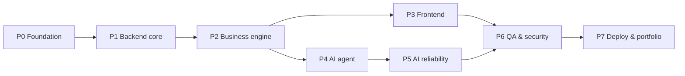

# 08 — Implementation Phases

> Status: Draft — ทุก phase ต้องได้รับอนุมัติก่อนเริ่ม และจบด้วย Final Report ตาม blueprint §20

## 1. Phase overview

P3 และ P4 ทำคู่ขนานได้หลัง API contract ของ P2 นิ่ง

| Phase | Week | Milestone |
|---|---|---|
| P0 Foundation | 1 | M1 |
| P1 Backend core | 2 | M2 |
| P2 Business engine | 3 | M3 |
| P3 Frontend | 4 | M4 |
| P4 AI agent | 5 | M5 |
| P5 AI reliability | 6 | M6 |
| P6 QA & security | 7 | M7 |
| P7 Deploy & portfolio | 8 | M8 |

## 2. Phases

### P0 — Foundation
**Prerequisites:** docs 00–09 approved; decisions D-01, D-02, D-04–D-06 approved
**Tasks**
- `git init`, `.gitignore`, `.editorconfig`, README skeleton
- `backend/` Go module, Fiber app with `/healthz`, config loader, slog logger, envelope + error mapper
- `deploy/docker-compose.dev.yml` (PostgreSQL 18), `.env.example`
- Migration tooling (goose) + empty first migration
- `frontend/` Next.js App Router + TS + antd scaffold
- CI (GitHub Actions): go vet/test/lint, frontend lint/typecheck
**Exit criteria:** `docker compose up` → API `/healthz` 200; CI green

### P1 — Backend core
**Tasks:** migrations (users, organizations, members, sessions, products, warehouses, inventory, sales); auth usecase (login/logout/me/switch org); session middleware; RBAC middleware; CSRF/origin check; member management; login rate limit; deterministic seed command
**Tests:** auth, session, RBAC matrix, tenant isolation harness
**Exit:** M2 — login works with seed users; isolation tests pass

### P2 — Business engine
**Tasks:** inventory repository + risk usecase + policy; sales summary/top/compare/anomaly; dashboard summary/trend; daterange helper with org timezone; REST handlers per API contract
**Tests:** table-driven calc tests (06 §2); repository integration against seed fixtures; API tests
**Exit:** M3 — all Module B–D endpoints return correct data without LLM

### P3 — Frontend
**Tasks:** API client (cookie, envelope, error handling), TanStack Query setup; Login; app layout + role-aware navigation; Dashboard (KPI cards, trend chart); Inventory list + risk page; Sales page (summary, top, compare); Member settings
**Tests:** Vitest for formatters/components; first Playwright journeys
**Exit:** M4

### P4 — AI agent
**Prerequisites:** D-08 provider/model + D-09 limits approved; Groq API key (ฟรี) ใน `.env` local
**Tasks:** provider interface + mock adapter + `openai_compat` adapter (Groq / Ollama); tool registry + 6 tools; agent loop with limits; conversations/messages endpoints; Copilot UI (chat + evidence panel)
**Tests:** agent loop cases (06 §5) with mock provider
**Exit:** M5 — first end-to-end question answered with evidence

### P5 — AI reliability
**Tasks:** audit tables + recording; execution detail endpoint & page; structured answer parsing + fidelity check; golden dataset + eval runner; prompt tuning
**Exit:** M6 — eval meets targets in 06 §6, results file committed

### P6 — QA & security
**Tasks:** complete E2E; security checklist (07); rate limits + daily cap; security headers; gitleaks/govulncheck/npm audit; bug fixes
**Exit:** M7 — release gate (06 §8) all checked

### P7 — Local packaging & portfolio
**Scope change (D-10, D-18):** ไม่มี VPS / domain / Nginx Proxy Manager ใน MVP — ทุกอย่างรันบน local
**Tasks:** Dockerfiles (multi-stage, non-root); `docker-compose.yml` ที่รันทั้ง stack (db + api + web) ด้วยคำสั่งเดียว; (optional) Portainer CE บน Docker Desktop เพื่อจัดการ stack; backup/restore scripts + tested restore; README (quick start local), architecture diagram, ERD, screenshots, demo video
**Exit:** M8 — clone repo → `docker compose up` → ใช้งานได้ตาม README; DoD v1.0 (ปรับข้อ deployment เป็น local)
**Demo (D-18):** live demo บนเครื่องตัวเอง + วิดีโอ; มี demo script และ checklist "ก่อนเริ่ม demo" (DB seed, LLM provider พร้อม, fallback `ollama`/`mock`)
**Post-MVP:** VPS deployment ผ่าน Portainer + NPM ตาม blueprint §16

## 3. Dependencies requiring approval (Proposed)

### Backend (Go)
| Package | Purpose |
|---|---|
| `github.com/gofiber/fiber/v3` | HTTP framework |
| `github.com/jackc/pgx/v5` (pgxpool) | PostgreSQL driver |
| `github.com/pressly/goose/v3` | SQL migrations |
| `golang.org/x/crypto/bcrypt` | Password hashing |
| `github.com/shopspring/decimal` | Money arithmetic |
| OpenAI-compatible HTTP client (เลือกใน P4: `net/http` เขียนเอง หรือ SDK ที่รองรับ base URL) | LLM adapter สำหรับ Groq / Ollama (D-08) |
| `github.com/stretchr/testify` | Test assertions |
| `github.com/testcontainers/testcontainers-go` | Integration test DB (optional; alternative: compose test DB) |

Validation: hand-written validators per request struct (หลีกเลี่ยง reflection-heavy library) — เปิดให้ทบทวน

### Frontend (npm)
`next`, `react`, `antd`, `@ant-design/nextjs-registry`, `@tanstack/react-query`, `react-hook-form`, `zod`, `@hookform/resolvers`, `dayjs`, chart library (`@ant-design/charts` หรือ `recharts` — D-16), `vitest`, `@testing-library/react`, `@playwright/test`

### Tooling
`golangci-lint`, `govulncheck`, `gitleaks`, GitHub Actions

## 4. Risks

| Risk | Impact | Mitigation |
|---|---|---|
| Scope creep (charts, extra tools) | Delay | Stick to PRD; log ideas in roadmap |
| LLM output variability | Flaky eval | Mock provider for CI; eval tracked over time, not CI gate |
| Timezone bugs | Wrong KPIs | Central daterange helper + boundary tests |
| Part-time schedule slip | Miss week 8 | P3/P4 parallel; cut anomaly detection first if needed |
| Public demo cost | Budget | Daily org cap; demo mode w/ mock provider fallback |
